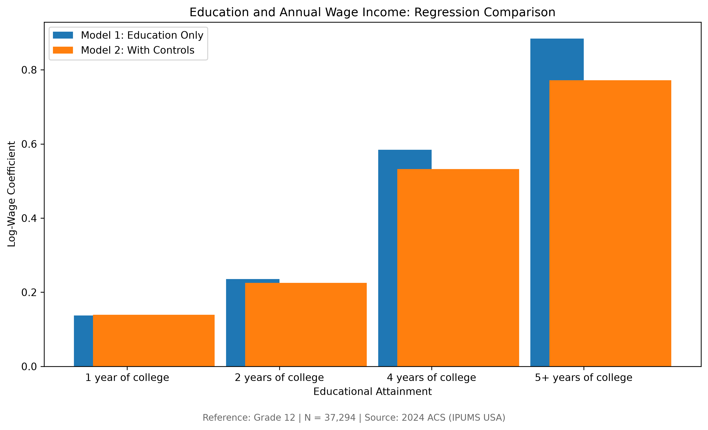

# Labor Market Econometrics
### Educational Attainment and Wage Income in the United States

An applied econometric analysis examining the relationship between educational attainment and annual wage income among working-age adults in the United States.

Using microdata from the **2024 American Community Survey (ACS)**, accessed through **IPUMS USA**, this project investigates how wage income varies across educational attainment levels and how these relationships change after accounting for additional worker characteristics.

The analysis combines **Python, SQL, and econometric regression techniques** to explore labor market outcomes using a sample of 37,294 adults ages 25-64 with positive annual wage income.

## Research Question

**How is educational attainment associated with annual wage income in the United States, and how does this relationship change after controlling for demographic characteristics, work intensity, and geographic location?**

The project approaches this question through descriptive statistics, survey-weighted wage comparisons, and two ordinary least squares (OLS) regression models.

The objective is to identify and interpret statistical relationships within the labor market, rather then establish causal effects.

## Data & Methodology

## Data Source

This project uses individual-level microdata from the **2024 American Community Survey (ACS) 1-Year Sample**, accessed through IPUMS USA.

The original extract contains 100,549 observations and 23 variables covering demographic characteristics, educational attainment, employment, geographic location, and wage income.

## Data Cleaning

The analysis sample was constructed using Python and pandas.

The cleaning pipeline:

1. Restricts the sample to adults ages 25-64.
2. Excludes observations with zero or missing annual wage income.
3. Removes special wage-income codes representing unavailable data.
4. Creates readable educational attainment categories.
5. Retains person-level survey weights for descriptive analysis.

The resulting dataset contains **37,294 observations**.

Because the sample includes only individuals reporting positive wage income, the findings should not be interpreted as representing all working-age adults.

### Econometric Approach

The analysis estimates two ordinary least squares (OLS) regression models using the natural logarithm of annual wage income as the dependent variable.

**Model 1 - Education Only**

Examines differences in log annual wage income across educatonal attainment categories, using Grade 12 as the reference category.

**Model 2 - Education with Controls**

Extends Model 1 by including:

- Age and age squared
- Sex
- Usual weekly work hours
- Weeks worked
- State fixed effects

Both models use **HC3 heteroskedasticity-robust standard errors**.

The regressions are unweighted. Survey weights are used separately in the descriptive wage comparisons. Consequently, the regression estimates should not be interpreted as fully survey-design-adjusted population estimates.

## Key Findings

### 1. Educational Attainment and Wage Income

Both regression models identify a positive association between higher educational attainment and annual wage income.

The table below presents estimated log-wage coefficients relative to workers in the Grade 12 educational attainament category.

| Educational Attainment | Model 1: Education Only | Model 2: With Controls |
|---|---:|---:|
| 1 year of college | 0.1375 | 0.1392 |
| 2 years of college | 0.2358 | 0.2252 |
| 4 years of college | 0.5844 | 0.5323 |
| 5+ years of college | 0.8843 | 0.7719 |

**Model 1** estimates differences in log annual wage income across education categories without additional controls.

**Model 2** adjusts for age, age squared, sex, usual weekly hours, weeks worked, and state fixed effects.

## 2. Education Associations Persist After Adding Controls

For individuals in the four-years-of-college category, the estimated coefficient decreases from 0.5844 in Model 1 to 0.5323 in Model 2.

Because the dependent variable is log-transformed, the Model 2 coefficient corresponds to approximately **70.3% higher annual wage income**, measured as a difference in conditional geometric means, relative to the Grade 12 category, holding the included covariates constant.

The reduction in the coefficient suggests that some of the initially observed wage differences overlap with differences in demographic characteristics, work intensity, and geographic location.

These estimates describe statistical associations and should not be interpreted as causal returns to education.

### 3. Model Explanatory Power

| Model | R-squared | Observations |
|---|---:|---:|
|Model 1: Education Only | 0.1141 | 37,294 |
|Model 2: With Controls | 0.5005 | 37,294 |

Model 1 explains approximately 11.4% of the variation in log annual wage income within the analysis sample.

After introducing additional covariates, Model 2 explains approximately 50.1%.

The increase in explanatory power indicates that demographic characteristics, work intensity, and geographic differences collectively account for substantial additional variation in annual wage income.

However, the higher R-squared does not establish that Model 2 identifies causal relationships or provides better out-of-sample predictions.

## Regression Visualization 

The figure below compares estimated education coefficients across both regression specifications.



The comparison illustrates how estimated education-wage associations change after introducing demographic, work-intensity, and geographic controls.

All coefficients are measured relative to the Grade 12 educational attainment category. The dependent variable is the natural logarithm of annual wage income.

## Research Limitations

Although this analysis identifies meaningful statistical relationships between educational attainment and annual wage income, several limitations should be considered.

## Repository Structure

```text
labor-market-econometrics/
│
├── data/
│   ├── raw/                  # Original IPUMS ACS data (not tracked)
│   └── processed/            # Cleaned analysis data (not tracked)
│
├── src/
│   ├── explore_data.py       # Exploratory data analysis
│   ├── clean_data.py         # Data cleaning pipeline
│   ├── sql_analysis.py       # SQLite database and SQL analysis
│   ├── regression_analysis.py # OLS regression models
│   └── visualize_results.py  # Regression visualizations
│
├── sql/
│   ├── wage_by_education.sql
│   └── weighted_wage_by_education.sql
│
├── reports/
│   ├── regression_comparison.csv
│   └── education_regression_comparison.png
│
├── notebooks/                # Reserved for future analyses
├── requirements.txt          # Python dependencies
├── .gitignore
└── README.md
```

### Technologies Used

- **Python:** pandas, NumPy, statsmodels, Matplotlib
- **SQL:** SQLite for querying individual-level wage data
- **Econometrics:** OLS regression, categorical variables, state fixed effects, HC3 robust standard errors
- **Data:** 2024 American Community Survey (ACS), accessed through IPUMS USA
- **Version Control:** Git and GitHub

## Reproducing the Analysis

### 1. Clone the Repository

```bash
git clone https://github.com/GabeTorrijos/labor-market-econometrics.git
cd labor-market-econometrics
```

### 2. Set Up the Python Environment

Create a virtual environment:

```bash
python3 -m venv .venv
```

Activate it on macOS or Linux:

```bash
source .venv/bin/activate
```

Install the required libraries:

```bash
pip install -r requirements.txt
```

### 3. Obtain the Data

The analysis uses the 2024 American Community Survey (ACS) 1-Year Sample, accessed through IPUMS USA.

To reproduce the analysis:

1. Create an IPUMS USA account.
2. Select the 2024 ACS 1-Year Sample.
3. Request the variables listed below.
4. Download the CSV extract.
5. Save the extracted CSV as `data/raw/usa_00002.csv`.

**Required IPUMS variables:**

```text
YEAR, SAMPLE, SERIAL, CBSERIAL, HHWT, CLUSTER,
STATEFIP, STRATA, GQ, PERNUM, PERWT, SEX, AGE,
RACE, RACED, EDUC, EDUCD, EMPSTAT, EMPSTATD,
OCC, WKSWORK1, UHRSWORK, INCWAGE
```

The raw data and processed datasets are excluded from version control.

### 4. Run the Analysis

Execute the scripts from the repository's root directory in the following order:

```bash
python src/explore_data.py
python src/clean_data.py
python src/sql_analysis.py
python src/regression_analysis.py
python src/visualize_results.py
```

The pipeline performs exploratory analysis, cleans the ACS microdata, constructs a SQLite database, calculates education-level wage statistics, estimates regression models, and generates a comparison visualization.

### 5. Review the Results

Generated outputs are stored in the `reports/` directory:

- `regression_comparison.csv` — Estimated education coefficients from both regression models.
- `education_regression_comparison.png` — Visualization comparing regression coefficients.

The SQLite database is generated locally in `data/labor_market.db`.

**Note:** Reproducing the exact reported estimates requires using the same IPUMS extract, sample selection, variable coding, and software environment.

### 1. Correlation Does Not Establish Causation

The regression coefficients represent conditional associations, ot causal effects of education on earnings.

Unobserved characteristics, including work experience, occupation-specific skills, and individual circumstances, may influence both educational attainment and wage outcomes.

### 2. Sample Selection

The analysis includes adults ages 25-64 who reported positive annual wage income.

Individuals without wage income are excluded, meaning the results do not describe the entire workign-age population.

### 3. Survey Design

Survey weights are incorporated into descriptive wage comparisons but not into the regression models.

Although the regressions use HC3 heteroskedasticity-robust standard errors, they do not account for the ACS's full complex survey design.

### 4. Measurement Limitations

Annual wage income reflects both compensation and labor supplied throughout the year.

Differences in annual earnings may therefore reflect differences in hourly compensation, weekly hours, and weeks worked.

Additionally, educational attainment categories do not necessarily correspond to completed degrees.

### 5. Cross-Sectional Analysis

The study uses data from a single year (2024).

Consequently, it cannot establish how individual earnings change over time or how education-wage relationships evolve across different economic conditions.